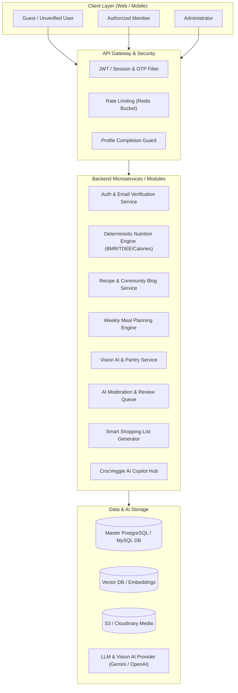
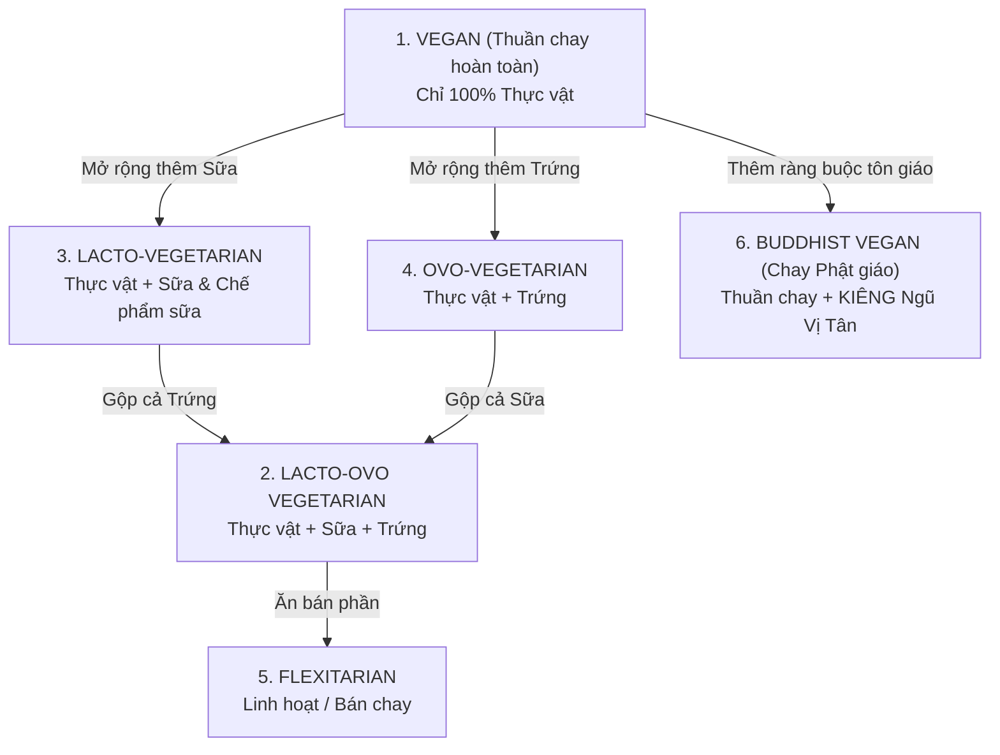
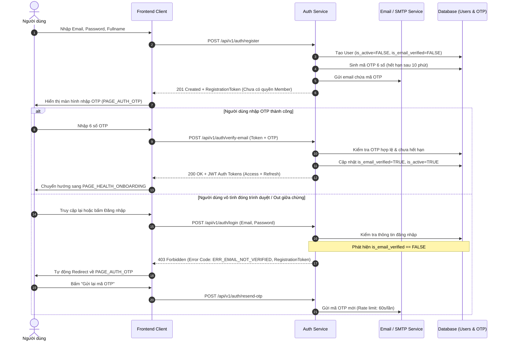
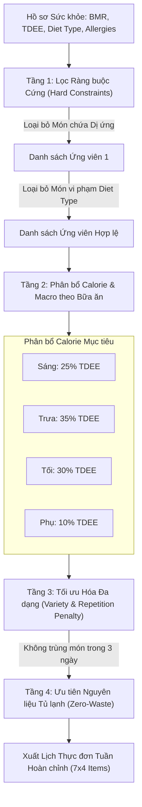
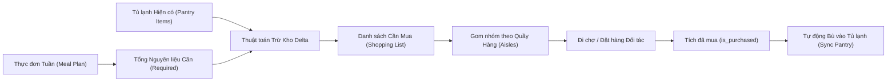

# TÀI LIỆU HƯỚNG DẪN KỸ THUẬT BACKEND: QUY TRÌNH NGHIỆP VỤ, RÀNG BUỘC VÀ ĐẶC TẢ YÊU CẦU HỆ THỐNG VEGEAI
**Dự án:** VEGEAI — Smart Vegetarian & Vegan Nutrition Lifestyle Platform (SWP391)  
**Đối tượng sử dụng:** Đội ngũ Kỹ sư Backend (Java Spring Boot / Node.js / Python AI Services), Database Engineers & QA  
**Phiên bản tài liệu:** v2.5 Enterprise Architecture Standard  
**Ngày cập nhật:** 2026-10-15  

---

## MỤC LỤC TỔNG QUAN
1. [TỔNG QUAN HỆ THỐNG VÀ NGUYÊN TẮC KIẾN TRÚC](#1-tổng-quan-hệ-thống-và-nguyên-tắc-kiến-trúc)
2. [DANH MỤC TRANG & MÀN HÌNH CHỨC NĂNG LIÊN QUAN](#2-danh-mục-trang--màn-hình-chức-năng-liên-quan)
3. [NGUYÊN LIỆU, CÔNG THỨC & MA TRẬN PHÂN LOẠI ĂN CHAY](#3-nguyên-liệu-công-thức--ma-trận-phân-loại-ăn-chay)
4. [TÍNH TOÁN CALORIE VÀ DINH DƯỠNG: TẤT ĐỊNH VS AI](#4-tính-toán-calorie-và-dinh-dưỡng-tất-định-vs-ai)
5. [CÁC YẾU TỐ "OUTSIDE-OF-THE-BOX" & GIA VỊ ẨN CẦN LƯU TÂM](#5-các-yếu-tố-outside-of-the-box--gia-vị-ẩn-cần-lưu-tâm)
6. [LUỒNG XÁC MINH EMAIL OTP & KHÔI PHỤC ĐĂNG KÝ DỞ](#6-luồng-xác-minh-email-otp--khôi-phục-đăng-ký-dở)
7. [LUỒNG ĐĂNG TẢI KHÁM PHÁ MÓN ĂN & AI TỰ ĐỘNG KIỂM DUYỆT 2 LỚP](#7-luồng-đăng-tải-khám-phá-món-ăn--ai-tự-động-kiểm-duyệt-2-lớp)
8. [THUẬT TOÁN ĐỀ XUẤT THỰC ĐƠN TUẦN (WEEKLY MEAL PLANNER)](#8-thuật-toán-đề-xuất-thực-đơn-tuần-weekly-meal-planner)
9. [CAMERA AI QUÉT TỦ LẠNH & ĐỀ XUẤT MÓN ĂN (FRIDGE VISION ENGINE)](#9-camera-ai-quét-tủ-lạnh--đề-xuất-món-ăn-fridge-vision-engine)
10. [MUA SẮM THÔNG MINH (SMART GROCERY & PANTRY SYNC)](#10-mua-sắm-thông-minh-smart-grocery--pantry-sync)
11. [TRỢ LÝ ẢO CROCVEGGIE AI COPILOT HUB](#11-trợ-lý-ảo-crocveggie-ai-copilot-hub)
12. [ĐẶC TẢ CƠ SỞ DỮ LIỆU BỔ SUNG (DDL & CONSTRAINTS)](#12-đặc-tả-cơ-sở-dữ-liệu-bổ-sung-ddl--constraints)
13. [HỢP ĐỒNG API (RESTFUL API SPECIFICATIONS & DTOS)](#13-hợp-đồng-api-restful-api-specifications--dtos)
14. [QUY TẮC BẢO MẬT, KIỂM THỬ VÀ CHECKLIST TRƯỚC KHI TRIỂN KHAI](#14-quy-tắc-bảo-mật-kiểm-thử-và-checklist-trước-khi-triển-khai)

---

## 1. TỔNG QUAN HỆ THỐNG VÀ NGUYÊN TẮC KIẾN TRÚC

Hệ sinh thái **VEGEAI** kết hợp giữa tính toán khoa học tất định (Deterministic Logic), quản lý thực phẩm có cấu trúc (Structured Inventory), và công nghệ trí tuệ nhân tạo (Generative & Vision AI).



### 7 Nguyên tắc Backend cốt tử (Non-Negotiable Architecture Rules)
1. **Dị ứng thực phẩm (Allergens) là Ràng buộc Cứng (Hard Constraint)**: Không bao giờ được gợi ý món ăn có chứa chất gây dị ứng cho người dùng, kể cả khi AI đề xuất hay người dùng yêu thích món đó. Lọc dị ứng phải chạy ở tầng Database Query trước khi đưa dữ liệu cho AI.
2. **Trường phái ăn chay là Ràng buộc Cứng (Hard Dietary Constraint)**: Người ăn chay Lacto (chỉ uống sữa, kiêng trứng) tuyệt đối không được nhận gợi ý món có trứng; Người thuần chay (Vegan) không được nhận gợi ý trứng, sữa, mật ong hay phụ gia gốc động vật.
3. **Phân tách Dữ liệu Tính toán Tất định và Ước tính AI**:
   - Chỉ số cơ thể ($BMI, BMR, TDEE$) và Calo món ăn dựa trên nguyên liệu Master DB phải tính toán bằng toán học thuần túy (`1: DETERMINISTIC_DB`).
   - Ước lượng qua hình ảnh hoặc đoạn chat phải gắn cờ `2: AI_ESTIMATED` và trả về nhãn `~` kèm chú thích miễn trừ trách nhiệm.
4. **AI không được tự ý thực hiện hành động phá hủy**: Khi kiểm duyệt nội dung người dùng đăng tải, nếu phát hiện vi phạm, AI chỉ được gắn cờ `FLAGGED_AI` và đẩy vào Hàng đợi Quản trị viên (Admin Review Queue), tuyệt đối không tự động xóa vĩnh viễn bài đăng của người dùng mà không có sự xét duyệt của con người (Human-in-the-loop).
5. **Dữ liệu đầu ra của AI là Untrusted Data**: Mọi JSON phản hồi từ LLM/Vision AI đều phải được Validate cấu trúc, bóc tách DTO và làm sạch (Sanitize) trước khi ghi vào Database.
6. **Xác thực Email OTP là bắt buộc**: Tài khoản chưa xác thực email không được phép đăng bài, bình luận, đánh giá hoặc lưu thực đơn cá nhân.
7. **Bảo vệ dữ liệu sức khỏe nhạy cảm**: Chiều cao, cân nặng, tiền sử dị ứng, và chế độ ăn của người dùng được xem là dữ liệu nhạy cảm; không bao giờ để lộ qua API công khai của người dùng khác.

---

## 2. DANH MỤC TRANG & MÀN HÌNH CHỨC NĂNG LIÊN QUAN

Để các kỹ sư Backend hiểu rõ điểm chạm người dùng (User Touchpoints), dưới đây là ma trận các trang chức năng và trách nhiệm xử lý của tầng Backend:

| STT | Tên Trang / Màn hình | Mã định danh UI | Mục đích & Trách nhiệm Backend | Ràng buộc quyền truy cập (RBAC) |
| :--- | :--- | :--- | :--- | :--- |
| **1** | **Xác minh Email OTP** | `PAGE_AUTH_OTP` | Nhận mã OTP 6 số, xác thực token tạm, chuyển trạng thái tài khoản thành kích hoạt, hỗ trợ gửi lại mã (Resend OTP). | Public (Có Token tạm thời) |
| **2** | **Onboarding Hồ sơ Sức khỏe** | `PAGE_HEALTH_ONBOARDING` | Nhận chiều cao, cân nặng, tuổi, giới tính, trường phái ăn chay, dị ứng; Tính toán $BMI, BMR, TDEE$ tất định. | Email Verified |
| **3** | **Khám phá Món ăn & Blog** | `PAGE_DISCOVER_FEED` | Cung cấp danh sách công thức/bài viết, bộ lọc Tag/Category, đề xuất cá nhân hóa dựa trên BMR & Trường phái ăn chay. | Public (Xem) / Member (Tương tác) |
| **4** | **Chi tiết Công thức / Blog** | `PAGE_RECIPE_DETAIL` | Hiển thị media (ảnh/video), danh sách nguyên liệu, các bước nấu, đánh giá sao (1-5 sao), bình luận, nút thêm vào thực đơn. | Public (Xem) / Member (Bình luận, Vote) |
| **5** | **Tạo & Đăng tải Món ăn** | `PAGE_RECIPE_CREATOR` | Tiếp nhận bản thảo công thức, gọi AI Moderation kiểm tra tính tường minh & vi phạm ăn chay, lưu nháp hoặc đẩy duyệt. | Member (Đã xác minh Email & Profile) |
| **6** | **Thực đơn tuần thông minh** | `PAGE_MEAL_PLANNER` | Ma trận 7 ngày $\times$ 4 bữa; Thuật toán phân bổ Calo theo BMR/TDEE; Đổi món tương đương Macro; Điểm chăm chỉ streak. | Member (Đã hoàn thiện Profile) |
| **7** | **Camera AI Quét tủ lạnh** | `PAGE_FRIDGE_SCANNER` | Tiếp nhận ảnh chụp tủ lạnh, Vision AI nhận diện nguyên liệu & độ tươi, người dùng xác nhận, gợi ý công thức tương thích. | Member |
| **8** | **Mua sắm thông minh** | `PAGE_SMART_SHOPPING` | Tự động lấy danh sách nguyên liệu thực đơn tuần trừ đi tồn kho tủ lạnh; gom nhóm theo quầy hàng siêu thị. | Member |
| **9** | **Trợ lý CrocVeggie AI Hub** | `PAGE_CROCVEGGIE_CHAT` | Context-aware Chatbot; giải đáp dinh dưỡng, gợi ý nguyên liệu thay thế; giới hạn 3 tin nhắn cho Guest. | Public (3 msgs) / Member (Unlimited) |
| **10**| **Admin Review Queue** | `PAGE_ADMIN_MODERATION`| Hiển thị các bài viết bị AI Flag vi phạm; Admin xem lý do AI gắn cờ và quyết định Duyệt hoặc Từ chối. | Admin Only (`ROLE_ADMIN`) |

---

## 3. NGUYÊN LIỆU, CÔNG THỨC & MA TRẬN PHÂN LOẠI ĂN CHAY

### 3.1. Hệ thống Phân cấp Chế độ Ăn chay (Vegetarian Strictness Hierarchy)

Các trường phái ăn chay tuân theo quy tắc tập hợp toán học có thứ bậc nghiêm ngặt:



### 3.2. Bảng Ma trận Tương thích Nguyên liệu (Ingredient Compatibility Matrix)

Mỗi nguyên liệu trong bảng `ingredients` bắt buộc được gán thuộc tính `vegetarian_compatibility` (TINYINT):

| Mã loại | Tên trường phái | Trứng (Eggs) | Sữa & Bơ (Dairy) | Mật ong (Honey) | Thịt/Cá (Meat/Fish) | Ngũ vị tân (Allium) |
| :---: | :--- | :---: | :---: | :---: | :---: | :---: |
| **1** | **VEGAN** (Thuần chay) | ❌ CẤM | ❌ CẤM | ❌ CẤM | ❌ CẤM | ✅ Được phép |
| **2** | **LACTO_OVO** (Trứng & Sữa) | ✅ Cho phép | ✅ Cho phép | ✅ Cho phép | ❌ CẤM | ✅ Được phép |
| **3** | **LACTO** (Chỉ sữa, kiêng trứng) | ❌ CẤM | ✅ Cho phép | ✅ Cho phép | ❌ CẤM | ✅ Được phép |
| **4** | **OVO** (Chỉ trứng, kiêng sữa) | ✅ Cho phép | ❌ CẤM | ✅ Cho phép | ❌ CẤM | ✅ Được phép |
| **5** | **FLEXITARIAN** (Linh hoạt) | ✅ Cho phép | ✅ Cho phép | ✅ Cho phép | ⚠️ Hạn chế | ✅ Được phép |
| **6** | **BUDDHIST_VEGAN** (Chay Tâm Linh) | ❌ CẤM | ❌ CẤM | ❌ CẤM | ❌ CẤM | ❌ CẤM (Hành, tỏi, kiệu, hẹ, nén) |

### 3.3. Quy tắc Kế thừa Chế độ Ăn của Công thức (Recipe Diet Strictness Inheritance)

> **QUY TẮC CỐT LÕI:** Chế độ ăn của một Recipe được quyết định bởi **nguyên liệu ít nghiêm ngặt nhất** (Least Restrictive Ingredient) có trong công thức đó.

Thuật toán xác định `diet_type_id` của Recipe:
1. Giả định ban đầu Recipe là `VEGAN` (Mức 1).
2. Lặp qua tất cả các nguyên liệu thành phần (`recipe_ingredients`):
   - Nếu phát hiện bất kỳ nguyên liệu nào là Thịt, Cá, Hải sản $\to$ Đánh dấu `NON_VEGETARIAN` $\to$ **Lập tức chặn đăng tải hoặc gắn cờ vi phạm**.
   - Nếu có nguyên liệu chứa Sữa VÀ có nguyên liệu chứa Trứng $\to$ Recipe bắt buộc là `LACTO_OVO` (Mức 2).
   - Nếu có nguyên liệu chứa Sữa nhưng KHÔNG có Trứng $\to$ Recipe là `LACTO` (Mức 3).
   - Nếu có nguyên liệu chứa Trứng nhưng KHÔNG có Sữa $\to$ Recipe là `OVO` (Mức 4).
   - Nếu phát hiện chứa Ngũ Vị Tân (Hành, tỏi, kiệu...) $\to$ Gỡ cờ tương thích `BUDDHIST_VEGAN`.
3. **Quy tắc Đề xuất cho Người dùng (Recommendation Match Rule)**:
   - Khi tìm kiếm món cho User có `user.diet_type_id`:
     - Nếu User là `VEGAN` $\to$ CHỈ gợi ý Recipe có `recipe.diet_type_id = VEGAN`.
     - Nếu User là `LACTO` $\to$ Gợi ý Recipe thuộc `VEGAN` hoặc `LACTO`. Tuyệt đối **LOẠI BỎ** `OVO` và `LACTO_OVO`.
     - Nếu User là `OVO` $\to$ Gợi ý Recipe thuộc `VEGAN` hoặc `OVO`. Tuyệt đối **LOẠI BỎ** `LACTO` và `LACTO_OVO`.
     - Nếu User là `LACTO_OVO` $\to$ Gợi ý Recipe thuộc `VEGAN`, `LACTO`, `OVO`, hoặc `LACTO_OVO`.

---

## 4. TÍNH TOÁN CALORIE VÀ DINH DƯỠNG: TẤT ĐỊNH VS AI

Hệ thống VEGEAI áp dụng ranh giới rõ ràng giữa toán học tất định (Deterministic) và ước lượng AI (AI-Estimated):

### 4.1. Công thức Tất định cho Chỉ số Sức khỏe Người dùng
Backend phải tự động tính toán và cập nhật vào bảng `user_health_profiles`:

1. **Chỉ số Khối Cơ thể (BMI)**:
   $$\text{BMI} = \frac{\text{weight\_kg}}{\left(\frac{\text{height\_cm}}{100}\right)^2} \quad (\text{Làm tròn 2 chữ số thập phân})$$

2. **Tỷ lệ Trao đổi Chất Cơ bản (BMR - Mifflin-St Jeor)**:
   - Đối với Nam giới (`gender_code = 1`):
     $$\text{BMR} = 10 \times \text{weight\_kg} + 6.25 \times \text{height\_cm} - 5 \times \text{age} + 5$$
   - Đối với Nữ giới (`gender_code = 2`):
     $$\text{BMR} = 10 \times \text{weight\_kg} + 6.25 \times \text{height\_cm} - 5 \times \text{age} - 161$$

3. **Tổng Năng lượng Tiêu hao Hàng ngày (TDEE)**:
   $$\text{TDEE} = \text{BMR} \times \text{Hệ số vận động}$$
   - `1: SEDENTARY` (Ít vận động) $\to 1.2$
   - `2: LIGHTLY_ACTIVE` (Nhẹ nhàng 1-3 ngày/tuần) $\to 1.375$
   - `3: MODERATELY_ACTIVE` (Vừa phải 3-5 ngày/tuần) $\to 1.55$
   - `4: VERY_ACTIVE` (Năng động 6-7 ngày/tuần) $\to 1.725$
   - `5: EXTRA_ACTIVE` (Vận động cường độ cao) $\to 1.9$

### 4.2. Công thức Tất định cho Calorie và Macro Món ăn
Tổng calo của một Recipe được tính tổng từ định lượng các nguyên liệu trong Master DB:

$$\text{Total\_Calories} = \sum_{i=1}^{n} \left( \frac{\text{ingredient\_calories\_per\_100g}_i}{100} \times \text{quantity\_grams}_i \right)$$

$$\text{Total\_Protein} = \sum_{i=1}^{n} \left( \frac{\text{ingredient\_protein\_per\_100g}_i}{100} \times \text{quantity\_grams}_i \right)$$

> [!IMPORTANT]
> Nếu tất cả nguyên liệu đều liên kết với Master DB có `is_verified_master = TRUE`, Recipe được gán cờ `calorie_source = 1 (DETERMINISTIC_DB)`.
> Nếu món ăn do AI bóc tách từ video/ảnh mà nguyên liệu chưa chuẩn hóa, hệ thống gán cờ `calorie_source = 2 (AI_ESTIMATED)`. Frontend sẽ hiển thị dạng `~450 kcal (AI Ước lượng)`.

---

## 5. CÁC YẾU TỐ "OUTSIDE-OF-THE-BOX" & GIA VỊ ẨN CẦN LƯU TÂM

Để xây dựng một hệ thống ăn chay chuẩn quốc tế và an toàn tuyệt đối cho người dùng, Backend cần giải quyết các bài toán biên (Edge Cases) thường bị bỏ quên:

### 5.1. Bẫy Gia vị Ẩn và Nguồn gốc Động vật (Hidden Animal Derivatives)
Nhiều thực phẩm tưởng chừng là chay nhưng thực chất chứa thành phần động vật:
- **Nước mắm & Nước tương**: Nước mắm truyền thống làm từ cá cơm. Phải kiểm tra ID nguyên liệu là *Nước mắm chay (làm từ dứa/đậu nành/nấm)*.
- **Gelatin**: Được chiết xuất từ da, xương heo hoặc bò (thường có trong kẹo dẻo, thạch mousse, viên nang vitamin) $\to$ **Không ăn chay**. Phải dùng *Agar-agar (Rau câu)* hoặc *Pectin*.
- **Rennet (Men làm đông phô mai)**: Chiết xuất từ dạ dày bê $\to$ Chỉ phô mai có nhãn *Microbial Rennet* hoặc *Vegetarian Cheese* mới hợp lệ cho Lacto/Lacto-Ovo.
- **Chất làm trong rượu/giấm (Isinglass)**: Làm từ bong bóng cá.
- **Màu đỏ cánh kiến (Carmine / Cochineal / E120)**: Phẩm màu làm từ bọ cánh kiến nghiền $\to$ Không thuần chay.
- **Mỡ động vật ẩn (Lard/Tallow)**: Thường dùng trong bánh pastry, vỏ bánh nướng, bánh đậu xanh truyền thống.

### 5.2. Quản lý Dị ứng Thực phẩm (Allergens Hard Filtering)
- Danh mục dị ứng cần hỗ trợ: **Đậu phộng (Peanuts)**, **Đậu nành (Soy)**, **Gluten (Lúa mì)**, **Hạt cây (Tree nuts: óc chó, hạnh nhân)**, **Mè/Vừng (Sesame)**, **Sữa bò (Cow milk)**, **Trứng (Egg)**.
- Khi người dùng đăng ký dị ứng trong bảng `user_allergies`:
  ```sql
  -- Truy vấn loại trừ nghiêm ngặt các Recipe vi phạm dị ứng
  SELECT r.recipe_id, r.title 
  FROM recipes r
  WHERE r.moderation_status = 1
    AND r.diet_type_id = :userDietType
    AND NOT EXISTS (
        SELECT 1 
        FROM recipe_ingredients ri
        JOIN ingredient_allergens ia ON ri.ingredient_id = ia.ingredient_id
        JOIN user_allergies ua ON ia.allergen_id = ua.allergen_id
        WHERE ri.recipe_id = r.recipe_id 
          AND ua.user_id = :currentUserId
          AND ua.is_hard_constraint = TRUE
    );
  ```

### 5.3. Công cụ Gợi ý Nguyên liệu Thay thế (Substitution Engine)
Khi người dùng muốn nấu một món nhưng bị thiếu nguyên liệu hoặc dị ứng, Backend hỗ trợ endpoint tra cứu nguyên liệu thay thế tương thích:
- Thay thế Trứng: Hạt chia ngâm nở (Chia egg), Aquafaba (nước luộc đậu gà), Chuối nghiền, Silken Tofu.
- Thay thế Sữa bò: Sữa yến mạch (Oat milk), Sữa hạnh nhân (Almond milk), Sữa đậu nành hữu cơ.
- Thay thế Bơ động vật: Bơ thực vật thuần chay (Vegan butter), Dầu dừa tinh luyện, Dầu quả bơ.
- Thay thế Mật ong: Mật hoa dừa, Si-rô cây phong (Maple syrup), Si-rô thùa (Agave).

---

## 6. LUỒNG XÁC MINH EMAIL OTP & KHÔI PHỤC ĐĂNG KÝ DỞ

Quy trình đăng ký tài khoản bắt buộc phải xác minh email để bảo vệ hệ sinh thái trước spam bot và bài đăng giả mạo.



### Ràng buộc kỹ thuật Backend cho Luồng OTP:
1. **Thời gian sống của OTP (TTL)**: Mã OTP có hiệu lực chính xác **10 phút**. Sau 10 phút, bản ghi OTP tự động vô hiệu hóa.
2. **Chống brute-force (Rate Limiting & Lockout)**:
   - Giới hạn nhập sai tối đa **5 lần**. Nếu nhập sai quá 5 lần, khóa mã OTP đó và bắt buộc người dùng yêu cầu gửi mã mới.
   - Khoảng cách giữa 2 lần bấm "Gửi lại mã" (Resend): tối thiểu **60 giây**.
3. **Phân quyền truy cập 3 tầng (3-Tier Access Control)**:
   - `Tier 1 - Khách vãng lai / Unverified`: Chỉ được xem bài viết công khai, gọi thử tối đa 3 tin nhắn CrocVeggie.
   - `Tier 2 - Verified Email (Chưa có Profile)`: Được phép xem và lưu bài, nhưng chưa được nhận đề xuất cá nhân hóa. Nếu cố truy cập tính năng Thực đơn tuần $\to$ Trả mã `428 PRECONDITION_REQUIRED` (Yêu cầu hoàn thiện hồ sơ dinh dưỡng).
   - `Tier 3 - Active Member (Verified Email + Profile)`: Mở khóa 100% tính năng hệ thống.

---

## 7. LUỒNG ĐĂNG TẢI KHÁM PHÁ MÓN ĂN & AI TỰ ĐỘNG KIỂM DUYỆT 2 LỚP

Mỗi bài viết công thức khi người dùng đăng tải phải đi qua phễu kiểm duyệt tự động nhằm bảo vệ người dùng ăn chay không bị tiêu thụ nhầm thực phẩm có hại hoặc sai chế độ.

```mermaid
flowchart TD
    Start["Người dùng Submit bài viết công thức"] --> PreVal["1. Tầng Kiểm tra Dữ liệu Cứng (Backend Validation)"]
    
    PreVal -->|Dữ liệu thiếu / Sai định dạng| RetErr["Trả lỗi 400 Bad Request"]
    PreVal -->|Hợp lệ| CalDet["2. Tính toán Calo & Macro tất định từ Master DB"]
    
    CalDet --> AI_Mod["3. Phân tích Nội dung bằng AI (Gemini Flash Service)"]
    
    subgraph AI_Inspection ["AI Moderation Engine"]
        Check1["Kiểm tra Tính tường minh giữa Nguyên liệu & Bước nấu"]
        Check2["Phát hiện Thịt, Cá, Hải sản, Gia vị mặn ẩn"]
        Check3["Đối chiếu Tag thể loại ăn chay (Vegan / Lacto...)"]
        Check4["Kiểm tra An toàn nội dung (Toxicity, Spam, Links)"]
    end
    
    AI_Mod --> AI_Inspection
    AI_Inspection --> Decision{"AI Đánh giá Vi phạm?"}
    
    Decision -->|An toàn 100% (Safety Score >= 0.90)| AutoApprove["Trạng thái 1: APPROVED<br>Công khai ngay lên Khám phá"]
    
    Decision -->|Nghi vấn hoặc Sai lệch Tag| FlagAI["Trạng thái 2: FLAGGED_AI<br>Đính kèm cờ & Lý do giải thích"]
    
    FlagAI --> AdminQueue["Đẩy vào Hàng đợi Admin (Review Queue)"]
    
    subgraph AdminAction ["Admin Duyệt Lần 2 (Human-in-the-loop)"]
        AdminView["Admin xem Báo cáo AI & Bản Diff"]
        AdminView -->|Phê duyệt| ApproveAdmin["Chuyển trạng thái 1: APPROVED"]
        AdminView -->|Yêu cầu sửa| RequestEdit["Chuyển trạng thái 4: PENDING_REVISION<br>Gửi thông báo cho Tác giả"]
        AdminView -->|Từ chối hẳn| RejectAdmin["Chuyển trạng thái 3: REJECTED"]
    end
    
    AdminQueue --> AdminAction
```

### Chi tiết Tiêu chí AI Moderation:
1. **Tính tường minh (Transparency & Step Consistency)**:
   - Các nguyên liệu liệt kê ở bảng nguyên liệu bắt buộc phải xuất hiện trong các bước nấu.
   - Nếu trong bước nấu xuất hiện nguyên liệu "lạ" không có trong danh sách khai báo ban đầu (ví dụ: bỗng nhiên nhắc "cho 2 thìa sốt mayonnaise trứng") $\to$ **AI gắn cờ vi phạm**: `ERR_UNDECLARED_INGREDIENTS`.
2. **Xác thực Tag Ăn chay (Diet Compatibility Check)**:
   - Tác giả gắn tag `VEGAN` nhưng trong nguyên liệu có Mật ong, Sữa bò hoặc Phô mai bò $\to$ AI gắn cờ: `VIOLATION_TAG_MISMATCH`.
   - Nếu phát hiện từ khóa liên quan đến thịt động vật (bò, gà, heo, tôm, cua, cá, mỡ heo, gelatin) $\to$ AI gắn cờ nghiêm trọng: `VIOLATION_NON_VEG_DETECTED`.
3. **Cấu trúc dữ liệu bài đăng chuẩn khi mở ra xem**:
   - `title`: Tiêu đề món ăn / bài blog.
   - `author`: Thông tin tác giả (`user_id`, `full_name`, `avatar_url`, điểm uy tín).
   - `media`: Ảnh bìa chất lượng cao (`cover_image_url`) và Cooking Video tùy chọn (`video_url`).
   - `ingredients`: Danh sách nguyên liệu chuẩn (Định lượng gram + Đơn vị hiển thị).
   - `cooking_steps`: Mảng các bước hướng dẫn chi tiết kèm thời gian.
   - `nutrition_summary`: Tổng calo, protein, carbs, fat (kèm nhãn nguồn gốc `DETERMINISTIC_DB` hoặc `AI_ESTIMATED`).
   - `ratings_and_reviews`: Đánh giá 1 đến 5 sao, số lượng review, bình luận lồng nhau.
   - `tags`: Tag phân loại (Món chính, Giảm cân, Nhanh gọn < 15 phút, Thuần chay...).

---

## 8. THUẬT TOÁN ĐỀ XUẤT THỰC ĐƠN TUẦN (WEEKLY MEAL PLANNER)

Thuật toán tạo suất ăn tự động cho cả tuần (7 ngày: Thứ 2 đến Chủ nhật, mỗi ngày 4 bữa: Sáng, Trưa, Tối, Phụ) được vận hành theo mô hình 4 tầng lọc:



### Công thức Phân bổ Calorie Mục tiêu Bữa ăn:
- Bữa Sáng (`BREAKFAST`): $Target = TDEE \times 25\% \quad (\text{Dung sai } \pm 10\%)$
- Bữa Trưa (`LUNCH`): $Target = TDEE \times 35\% \quad (\text{Dung sai } \pm 10\%)$
- Bữa Tối (`DINNER`): $Target = TDEE \times 30\% \quad (\text{Dung sai } \pm 10\%)$
- Bữa Phụ (`SNACK`): $Target = TDEE \times 10\% \quad (\text{Dung sai } \pm 10\%)$

### Tính năng Đổi Món Tương Đương (Smart Meal Swap):
Khi người dùng bấm nút [Đổi món] tại một bữa ăn cụ thể, Backend truy vấn công thức thay thế thỏa mãn:
1. Cùng loại bữa ăn (`meal_type_code`).
2. Tương thích chế độ ăn chay và không chứa chất dị ứng của người dùng.
3. $|\text{Calories}_{\text{Mới}} - \text{Calories}_{\text{Cũ}}| \le 10\% \times \text{Calories}_{\text{Cũ}}$.
4. $|\text{Protein}_{\text{Mới}} - \text{Protein}_{\text{Cũ}}| \le 15\% \times \text{Protein}_{\text{Cũ}}$.

---

## 9. CAMERA AI QUÉT TỦ LẠNH & ĐỀ XUẤT MÓN ĂN (FRIDGE VISION ENGINE)

Hệ thống Camera AI cho phép người dùng chụp ảnh bên trong tủ lạnh và bóc tách dữ liệu nguyên liệu theo thời gian thực (SLA $\le 3000\text{ms}$).

### 9.1. Luồng Xử lý Thị giác Máy tính (Vision Processing Pipeline)
1. **Upload & Nén ảnh**: Ảnh gửi lên từ mobile/web được kiểm tra MIME type (`image/jpeg`, `image/png`, `image/webp`), kích thước tối đa 10MB.
2. **Gọi Vision AI (Gemini 1.5 Flash / Pro)** với Structured Prompt yêu cầu trả về mảng JSON:
   ```json
   {
     "detected_items": [
       {
         "raw_label": "Đậu hũ non",
         "confidence": 0.96,
         "estimated_quantity_grams": 300,
         "freshness_indicator": "FRESH",
         "days_until_spoilage": 3
       },
       {
         "raw_label": "Cà chua",
         "confidence": 0.89,
         "estimated_quantity_grams": 250,
         "freshness_indicator": "USE_SOON",
         "days_until_spoilage": 1
       }
     ]
   }
   ```
3. **Ước tính Độ tươi mới (Freshness Estimation Logic)**:
   - `FRESH`: Màu sắc tự nhiên, bề mặt căng mịn $\to$ Khuyên dùng trong 5-7 ngày.
   - `USE_SOON`: Xuất hiện vết thâm nhẹ, lá hơi héo, cà chua mềm $\to$ Khuyên dùng trong 24-48 giờ $\to$ **Ưu tiên đẩy vào công thức nấu ngay trong ngày**.
   - `SPOILED`: Có mốc, chảy nhớt, biến màu nặng $\to$ Cảnh báo loại bỏ, không đề xuất nấu.
4. **Cổng Xác nhận Người dùng (User Confirmation Gate - Bắt buộc)**:
   - Backend **KHÔNG** tự ý ghi đè nguyên liệu vào tủ lạnh (`pantry_items`) ngay lập tức.
   - Kết quả nhận diện được trả về dưới dạng bản nháp tạm thời (`detected_ingredients` với `is_confirmed_by_user = FALSE`).
   - Người dùng có quyền thêm, sửa số lượng hoặc xóa bỏ những món nhận diện sai trước khi bấm [Xác nhận lưu vào Tủ lạnh].

### 9.2. Thuật toán Khớp Món Ăn từ Tủ Lạnh (Pantry Recipe Matching Algorithm)

Chỉ số Bao phủ Nguyên liệu (Coverage Score):
$$\text{Coverage Score} = \frac{\sum \text{Nguyên liệu có sẵn trong tủ lạnh đạt yêu cầu}}{\text{Tổng số nguyên liệu công thức yêu cầu}}$$

**Quy tắc Xếp hạng Đề xuất:**
1. **Ưu tiên 1**: Công thức sử dụng nguyên liệu đang ở mức `USE_SOON` (Chống lãng phí thực phẩm - Zero Waste).
2. **Ưu tiên 2**: $\text{Coverage Score} \ge 0.70$ (Món ăn đã có sẵn ít nhất 70% nguyên liệu).
3. **Ưu tiên 3**: Phù hợp với BMR và Calorie còn lại trong ngày của người dùng.

---

## 10. MUA SẮM THÔNG MINH (SMART GROCERY & PANTRY SYNC)

Tính năng Mua sắm thông minh khép kín vòng lặp dinh dưỡng của VEGEAI:



### Công thức Tính toán Danh sách Cần Mua:
$$\text{Cần mua}_i = \max\left(0, \sum_{\text{tuần}} \text{Định lượng}_i - \text{Tồn kho tủ lạnh}_i\right)$$

- Nếu $\text{Tồn kho} \ge \text{Định lượng cần}$, nguyên liệu đó sẽ **KHÔNG** xuất hiện trong danh sách đi chợ.
- Tự động gom nhóm theo quầy hàng siêu thị:
  - *Quầy Rau Củ Tươi*: Cà rốt, cải thìa, nấm đùi gà...
  - *Quầy Đậu Phụ & Thực phẩm Chay Lạnh*: Đậu hũ non, mì căn, chả lụa chay...
  - *Quầy Gia vị & Đồ khô*: Dầu mè, nước tương lên men, hạt nêm nấm hương...
  - *Quầy Các loại Hạt & Ngũ cốc*: Gạo lứt, hạt quinoa, yến mạch...

---

## 11. TRỢ LÝ ẢO CROCVEGGIE AI COPILOT HUB

CrocVeggie là trợ lý ảo nhận biết ngữ cảnh (Context-Aware AI) phục vụ xuyên suốt toàn bộ ứng dụng:

### 11.1. Ma trận Ngữ cảnh (Context Matrix)
Khi gọi API chat `POST /api/v1/ai/chat`, client gửi kèm `context_screen` và `context_entity_id`:

| `context_screen` | Dữ liệu ngữ cảnh Backend inject vào System Prompt | Khả năng Trợ lý |
| :--- | :--- | :--- |
| `FRIDGE` | Danh sách nguyên liệu vừa quét từ tủ lạnh + độ tươi. | "Gợi ý cho tôi món ăn từ đậu hũ và cà chua đang sắp hỏng trong tủ." |
| `RECIPE` | Chi tiết công thức, định lượng và thành phần dinh dưỡng. | "Tôi có thể thay thế hạt điều bằng nguyên liệu gì nếu bị dị ứng?" |
| `MEAL_PLAN` | Lịch thực đơn 7 ngày và trạng thái calo thừa/thiếu. | "Tại sao thứ 4 tôi lại thiếu đạm? Hãy đề xuất món trưa giàu protein hơn." |
| `PROFILE` | Chiều cao, cân nặng, BMI, BMR, TDEE và mục tiêu giảm/tăng cân. | "Với BMR 1450 kcal, tôi nên phân bổ calo các bữa ăn như thế nào?" |

### 11.2. Hạn mức Tin nhắn cho Khách vãng lai (Guest Limit Enforcement)
- Khách chưa đăng nhập (`ROLE_GUEST` hoặc `user_id = NULL`):
  - Theo dõi qua `session_id` (Lưu trong Cookie/LocalStorage hoặc Redis).
  - Tối đa **3 tin nhắn dùng thử**.
  - Khi `message_count >= 3`, chuyển cờ `is_locked = TRUE`, trả về mã lỗi `403 FORBIDDEN` kèm thông báo: `TRIAL_LIMIT_REACHED: Vui lòng đăng ký tài khoản thành viên để tiếp tục trò chuyện cùng CrocVeggie`.

---

## 12. ĐẶC TẢ CƠ SỞ DỮ LIỆU BỔ SUNG (DDL & CONSTRAINTS)

Để phục vụ trọn vẹn các yêu cầu về Đánh giá sao, Bình luận, Xác minh Email OTP và Phân loại Tag theo yêu cầu của dự án, dưới đây là mã nguồn DDL bổ sung cần thực thi trên Database:

```sql
-- ==============================================================================
-- PHÂN HỆ BỔ SUNG: AUTH OTP, REVIEWS & MODERATION EXTENSIONS
-- ==============================================================================

-- 1. Bảng lưu trữ mã OTP xác minh email
CREATE TABLE email_verifications (
    verification_id CHAR(36) NOT NULL,
    email VARCHAR(255) NOT NULL,
    otp_code VARCHAR(10) NOT NULL,
    token_hash VARCHAR(255) NOT NULL,
    attempt_count TINYINT NOT NULL DEFAULT 0,
    is_verified BOOLEAN NOT NULL DEFAULT FALSE,
    expires_at TIMESTAMP NOT NULL,
    created_at TIMESTAMP NOT NULL DEFAULT CURRENT_TIMESTAMP,
    CONSTRAINT pk_email_verifications PRIMARY KEY (verification_id)
);
CREATE INDEX idx_email_verifications_lookup ON email_verifications(email, otp_code, is_verified);

-- 2. Bảng Danh mục Phân loại Món ăn & Khám phá (Taxonomy Categories)
CREATE TABLE recipe_categories (
    category_id SMALLINT NOT NULL,
    category_code VARCHAR(50) NOT NULL,          -- BREAKFAST, QUICK_EASY, HIGH_PROTEIN, DETOX...
    category_name NVARCHAR(100) NOT NULL,        -- Bữa sáng, Nhanh gọn < 15p, Giàu đạm...
    description NVARCHAR(255) NULL,
    icon_url VARCHAR(500) NULL,
    CONSTRAINT pk_recipe_categories PRIMARY KEY (category_id),
    CONSTRAINT uq_recipe_categories_code UNIQUE (category_code)
);

-- 3. Bảng Ánh xạ Nhiều-Nhiều giữa Recipe và Category
CREATE TABLE recipe_category_mappings (
    mapping_id CHAR(36) NOT NULL,
    recipe_id CHAR(36) NOT NULL,
    category_id SMALLINT NOT NULL,
    CONSTRAINT pk_recipe_category_mappings PRIMARY KEY (mapping_id),
    CONSTRAINT fk_rcm_recipe FOREIGN KEY (recipe_id) 
        REFERENCES recipes(recipe_id) ON DELETE CASCADE,
    CONSTRAINT fk_rcm_category FOREIGN KEY (category_id) 
        REFERENCES recipe_categories(category_id) ON DELETE CASCADE,
    CONSTRAINT uq_recipe_category UNIQUE (recipe_id, category_id)
);

-- 4. Bảng Đánh giá Sao & Bình luận Công thức (Reviews & 5-Star Ratings)
CREATE TABLE recipe_reviews (
    review_id CHAR(36) NOT NULL,
    recipe_id CHAR(36) NOT NULL,
    user_id CHAR(36) NOT NULL,
    rating_stars TINYINT NOT NULL,               -- Giá trị 1 đến 5 sao
    comment_text NVARCHAR(1000) NOT NULL,
    attached_image_url VARCHAR(1000) NULL,       -- Ảnh thành phẩm người dùng tự chụp
    parent_review_id CHAR(36) NULL,              -- Hỗ trợ bình luận lồng nhau (Reply)
    like_count INT NOT NULL DEFAULT 0,
    is_hidden BOOLEAN NOT NULL DEFAULT FALSE,    -- Ẩn nếu vi phạm nội dung
    created_at TIMESTAMP NOT NULL DEFAULT CURRENT_TIMESTAMP,
    updated_at TIMESTAMP NOT NULL DEFAULT CURRENT_TIMESTAMP,
    CONSTRAINT pk_recipe_reviews PRIMARY KEY (review_id),
    CONSTRAINT fk_reviews_recipe FOREIGN KEY (recipe_id) 
        REFERENCES recipes(recipe_id) ON DELETE CASCADE,
    CONSTRAINT fk_reviews_user FOREIGN KEY (user_id) 
        REFERENCES users(user_id) ON DELETE CASCADE,
    CONSTRAINT fk_reviews_parent FOREIGN KEY (parent_review_id) 
        REFERENCES recipe_reviews(review_id) ON DELETE CASCADE,
    CONSTRAINT chk_rating_range CHECK (rating_stars >= 1 AND rating_stars <= 5)
);
CREATE INDEX idx_reviews_recipe_created ON recipe_reviews(recipe_id, created_at DESC);

-- 5. Bảng Nhật ký Kiểm duyệt AI (AI Moderation Audit Logs)
CREATE TABLE ai_moderation_logs (
    log_id CHAR(36) NOT NULL,
    recipe_id CHAR(36) NOT NULL,
    ai_model_version VARCHAR(100) NOT NULL,      -- e.g., 'gemini-1.5-flash-002'
    safety_score DECIMAL(3, 2) NOT NULL,         -- 0.00 đến 1.00
    violation_code VARCHAR(50) NULL,             -- DIET_MISMATCH, HIDDEN_MEAT, INCONSISTENT_STEPS
    ai_reasoning TEXT NOT NULL,                  -- Phân tích chi tiết của AI
    admin_action TINYINT NULL,                   -- 1: OVERRIDDEN_APPROVE, 2: CONFIRMED_REJECT
    admin_id CHAR(36) NULL,
    reviewed_at TIMESTAMP NULL,
    created_at TIMESTAMP NOT NULL DEFAULT CURRENT_TIMESTAMP,
    CONSTRAINT pk_ai_moderation_logs PRIMARY KEY (log_id),
    CONSTRAINT fk_mod_logs_recipe FOREIGN KEY (recipe_id) 
        REFERENCES recipes(recipe_id) ON DELETE CASCADE
);
```

---

## 13. HỢP ĐỒNG API (RESTFUL API SPECIFICATIONS & DTOS)

Dưới đây là các API chính mà kỹ sư Backend cần hiện thực hóa:

### 13.1. Phân hệ Xác thực & Email OTP
- `POST /api/v1/auth/register`: Đăng ký tài khoản mới $\to$ Gửi OTP qua email.
- `POST /api/v1/auth/verify-email`: Xác nhận mã OTP 6 chữ số $\to$ Kích hoạt tài khoản & cấp JWT Tokens.
- `POST /api/v1/auth/resend-otp`: Gửi lại mã OTP mới (Rate limit 60s).
- `GET /api/v1/auth/registration-status`: Kiểm tra tiến trình đăng ký của email (phục vụ điều hướng khi user out giữa chừng).

### 13.2. Phân hệ Khám phá Món ăn & Đăng tải
- `GET /api/v1/recipes/discover`: Lấy danh sách công thức với bộ lọc đa chiều:
  - Query Params: `category`, `diet_type`, `max_calories`, `max_cook_time`, `page`, `size`.
- `GET /api/v1/recipes/{recipeId}`: Lấy chi tiết công thức (bao gồm dinh dưỡng, tác giả, các bước, điểm đánh giá trung bình).
- `POST /api/v1/recipes`: Đăng tải công thức mới.
  - **Payload DTO**:
    ```json
    {
      "title": "Đậu Hũ Sốt Cà Chua Thuần Chay",
      "diet_type_id": 1,
      "prep_time_minutes": 10,
      "cook_time_minutes": 15,
      "cover_image_url": "https://storage.vegeai.app/recipes/tofu-tomato.jpg",
      "video_url": null,
      "category_ids": [1, 2],
      "ingredients": [
        { "ingredient_id": "uuid-dau-hu-non", "quantity_grams": 200, "display_unit": "2 bìa" },
        { "ingredient_id": "uuid-ca-chua", "quantity_grams": 150, "display_unit": "2 quả" },
        { "ingredient_id": "uuid-dau-me", "quantity_grams": 10, "display_unit": "1 thìa cà phê" }
      ],
      "cooking_steps": [
        { "step_number": 1, "instruction": "Cắt đậu hũ thành khối vuông vừa ăn." },
        { "step_number": 2, "instruction": "Xào nhuyễn cà chua với dầu mè tạo sốt sánh mịn." },
        { "step_number": 3, "instruction": "Cho đậu vào đun nhỏ lửa trong 5 phút cho ngấm gia vị." }
      ]
    }
    ```
- `POST /api/v1/recipes/{recipeId}/reviews`: Đăng bình luận và chấm điểm 1-5 sao.

### 13.3. Phân hệ Camera AI & Tủ lạnh
- `POST /api/v1/fridge/scan`: Upload ảnh tủ lạnh $\to$ Gọi Vision AI phân tích nguyên liệu & độ tươi.
- `POST /api/v1/fridge/confirm-items`: Người dùng xác nhận danh sách nguyên liệu $\to$ Cập nhật vào kho `pantry_items`.
- `GET /api/v1/fridge/recommendations`: Đề xuất các món ăn tối ưu nhất dựa trên nguyên liệu tủ lạnh hiện có.

### 13.4. Phân hệ Thực đơn Tuần & Mua sắm
- `GET /api/v1/meal-plans/weekly/current`: Lấy kế hoạch bữa ăn tuần hiện tại của người dùng.
- `POST /api/v1/meal-plans/weekly/auto-generate`: Thuật toán tự động sinh thực đơn 7 ngày dựa trên BMR/TDEE & Chế độ ăn.
- `POST /api/v1/meal-plans/items/{planItemId}/swap`: Đổi món tương đương về calo và protein.
- `POST /api/v1/shopping-lists/generate-from-plan`: Tạo danh sách đi chợ tự động (đã trừ tồn kho tủ lạnh).

---

## 14. QUY TẮC BẢO MẬT, KIỂM THỬ VÀ CHECKLIST TRƯỚC KHI TRIỂN KHAI

### 14.1. Ma trận Kiểm thử Đơn vị & Tích hợp (Unit & Integration Tests)
Backend developers bắt buộc viết Unit Test bao phủ các ca kiểm thử then chốt:

- [ ] **Test Case 1 (Allergy Blocker)**: Thêm nguyên liệu có chứa đậu phộng vào thực đơn của người dùng bị dị ứng đậu phộng $\to$ Kết quả mong đợi: `400 Bad Request` hoặc `AllergyViolationException`, giao dịch bị hủy bỏ hoàn toàn.
- [ ] **Test Case 2 (Diet Strictness Violation)**: Gắn tag `VEGAN` cho công thức có chứa sữa bò hoặc lòng đỏ trứng $\to$ Kết quả mong đợi: AI Moderation phát hiện và chuyển trạng thái `FLAGGED_AI`.
- [ ] **Test Case 3 (Deterministic vs AI)**: Kiểm tra công thức calo từ nguyên liệu Master DB $\to$ Kết quả tính toán phải khớp chính xác tuyệt đối với tổng của từng nguyên liệu chia 100 nhân khối lượng.
- [ ] **Test Case 4 (OTP Expiry)**: Nhập mã OTP vào phút thứ 11 sau khi gửi $\to$ Kết quả mong đợi: `400 Bad Request` (Mã OTP đã hết hạn).
- [ ] **Test Case 5 (Guest Message Limiter)**: Khách vãng lai gửi tin nhắn thứ 4 trong cùng 1 session $\to$ Kết quả mong đợi: `403 Forbidden` (`TRIAL_LIMIT_REACHED`).

### 14.2. Checklist Nghiệp vụ cho Kỹ sư Backend trước khi bàn giao
1. **Kiểm tra SQL Injection**: Toàn bộ câu lệnh SQL/JPA sử dụng Parameterized Query.
2. **Kiểm tra N+1 Query**: Eager Fetch hoặc `@EntityGraph` cho quan hệ `Recipe` $\to$ `RecipeIngredients` $\to$ `Ingredients`.
3. **Mã hóa Mật khẩu**: Sử dụng thuật toán `BCrypt` với độ dài muối (Salt factor) $\ge 12$ hoặc `Argon2id`.
4. **Không lộ thông tin nhạy cảm (Sanitization)**: DTO trả về cho User không bao giờ chứa `password_hash`, `email_verification_token` hay các log lỗi hệ thống bên trong.
5. **Cấu hình Bất đồng bộ (Async Execution)**: Các tác vụ quét ảnh Vision AI, kiểm duyệt nội dung LLM, và gửi mail OTP phải được thực thi qua `@Async` hoặc Message Queue (RabbitMQ/Kafka) để không làm block luồng HTTP của người dùng.

---
*Tài liệu này là đặc tả nghiệp vụ chuẩn (Master Implementation Guide) dành cho đội ngũ phát triển Backend VEGEAI. Mọi thắc mắc và đề xuất cập nhật cần được thảo luận và đồng thuận cùng Tech Lead & Solution Architect.*
